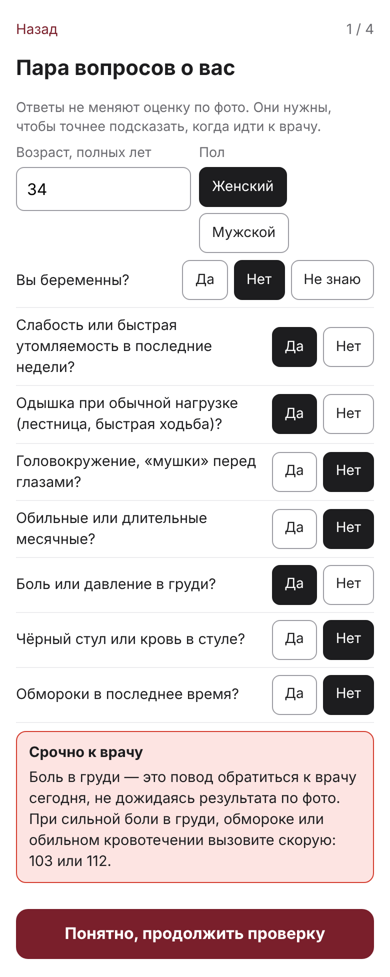
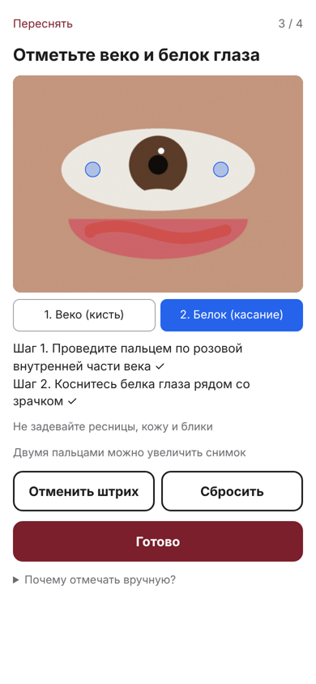
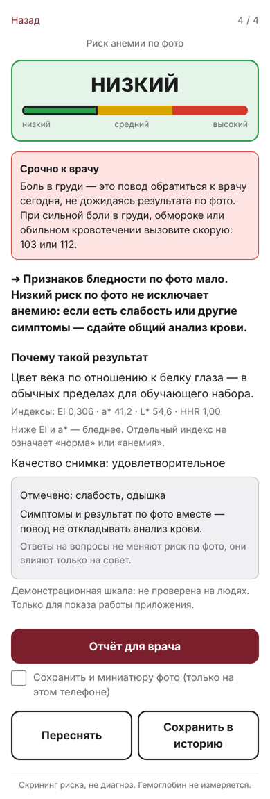
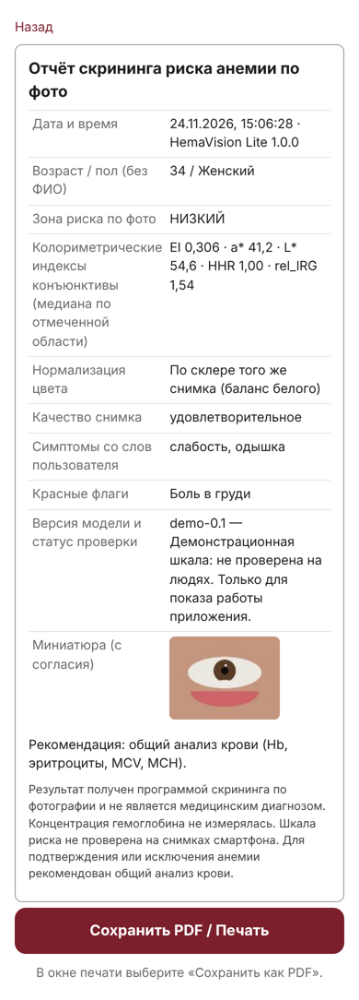

# HemaVision Lite

**Офлайн-приложение для скрининга риска анемии по фото внутренней стороны нижнего века.**
Мы не ставим диагноз: приложение показывает шкалу риска и подсказывает, когда сдать анализ крови.
Гемоглобин не измеряется.

- Работает в браузере телефона и **без интернета** после первой загрузки (PWA).
- Фото **не покидает телефон**: нет сервера, аналитики, CDN и сетевых запросов после установки.
- Путь: опрос → камера с проверкой качества → отметка века и белка глаза → цветовые индексы → шкала риска → отчёт для врача (PDF) → история.

## Попробовать за 1 минуту

1. Откройте на телефоне **https://zhansaya-afk.github.io/hemavision-lite/** (Chrome на Android или Safari на iPhone).
2. Android: меню ⋮ → «Установить приложение». iPhone: «Поделиться» → «На экран Домой».
3. Включите режим полёта и откройте приложение с экрана: всё работает.
4. Нет камеры или чёрный экран — кнопка «Загрузить фото».

Локально: `python3 -m http.server 8000` в корне репозитория → `http://localhost:8000` (камере нужен https или localhost).

## Скриншоты

| Опрос | Отметка тканей | Результат | Отчёт для врача |
|---|---|---|---|
|  |  |  |  |

Снимок глаза на скриншотах — рисунок, не фото человека.

## Архитектура

```
index.html ─ app.js (экраны, состояние сеанса)
  ├─ src/personalizer.js  опрос: отказ до 5 лет, красные флаги, заметки (подростки, беременность)
  ├─ src/camera.js        задняя камера, рамка-овал, снимок; запасной путь — файл
  ├─ src/quality.js       свет, пересвет, резкость (Лапласиан), видно ли веко, цвет света по склере
  ├─ src/roi.js           ручная отметка: кисть по веку, касания по белку глаза
  ├─ src/color.js         sRGB↔линейный, CIELAB, HSI, EI, HHR — чистые функции
  ├─ src/features.js      маска ткани (без бликов, теней, ресниц), баланс белого по склере, медианы
  ├─ src/risk.js          model.json → вероятность → зона; плохое качество → «оценка ненадёжна» без цифр
  ├─ src/report.js        отчёт для врача (печать браузером в PDF)
  ├─ src/store.js         история в IndexedDB на телефоне
  └─ sw.js, manifest      офлайн: все файлы в кэше, ответы только из кэша
tools/  train_model.py (Colab: обучение шкалы), make_golden.py (эталон формул), make_i18n.py (тексты)
tests/  node --test: формулы против эталона, качество, шкала, правила опроса
```

**Почему отметка вручную.** Мы не угадываем, где веко: пользователь проводит пальцем по розовой части,
а программа сама убирает внутри отметки блики, тени и ресницы. Это надёжнее автоматической сегментации
в браузере за 48 часов и делает ответ проверяемым: видно, по какой ткани он получен.

**Почему белок глаза.** Свет и камера меняют цвет века и склеры одинаково. Баланс белого по склере того же
снимка (линейный RGB, модель фон Криса) убирает оттенок освещения. Если склера сильно жёлтая или синяя
(|b\*| > 15) или в тени — приложение отказывается считать и просит переснять.

## Формулы

Все признаки — медианы по чистым пикселям ткани, не цвет среднего пикселя.

| Индекс | Формула | Смысл |
|---|---|---|
| EI (Erythema Index) | log10(R) − log10(G) | гемоглобин поглощает зелёный → бледность снижает EI |
| a\* (CIELAB, D65) | из линейного RGB через XYZ | краснота |
| L\* | светлота | |
| HHR (High Hue Ratio) | доля пикселей с оттенком HSI \|H\| < 10° | доля «красной» ткани |
| rel_lRG | ln((R/G)века / (R/G)склеры), линейный RGB | цвет века относительно склеры, свет сокращается |

## Тесты

```bash
npm test          # = node --test, нужен Node 18+
```

Формулы JS сверяются с эталоном `tests/golden.json` (15 цветов + синтетический кадр с бликами и ресницами):
Lab — допуск 0,2 (OpenCV считает гамму по таблице), остальное — 1e-3. Отдельно проверено, что
множитель «тёплого» света сокращается в отношениях «веко/склера», что зона «ненадёжно» не выдаёт
вероятность и что ответы опроса не меняют зону по фото.

## Шкала риска и честные цифры

Шкала — логистическая регрессия на 4 признаках века (EI, a\*, L\*, HHR), `model/model.json`.

- Пока в репозитории `status: "demo"`: коэффициенты заданы вручную, **на людях не проверены**.
  Приложение пишет это на экране результата и в отчёте.
- `tools/train_model.py` обучает шкалу в Google Colab на открытом наборе Eyes-defy-anemia
  (взрослые, Италия и Индия, снимки с макронасадкой). Проверка — по пациентам (StratifiedGroupKFold, 5 фолдов),
  пороги зон подбираются только на обучающих фолдах. Результат — `model/metrics.md` с 95% ДИ, отдельно по странам.
- **На снимках смартфона точность не измерена.** Набор снят макронасадкой с LED, телефон — другой домен.
  Это главное ограничение и следующий шаг (пилот с анализом крови в тот же день).

## Приватность и безопасность

- Нет сетевых запросов после установки: проверяется в DevTools → Network в режиме полёта.
- CSP: `default-src 'self'`, скрипты только свои, без inline-кода и сторонних доменов.
- Фото по умолчанию не сохраняется; в историю пишутся только числа. Миниатюра — только по галочке.
- «Удалить всю историю» — одна кнопка. Подробно — `PRIVACY.md`.

## Ограничения

- Не диагноз и не измерение гемоглобина.
- Шкала построена на снимках взрослых с макронасадкой; на смартфоне не проверена.
- Жёлтый свет, вспышка, косметика, воспаление глаза искажают цвет.
- Дети до 5 лет — отказ. Подростки и беременные — предупреждение «результат менее надёжен».

## Код, библиотеки, данные

См. `LIBRARIES.md`. В рантайме приложения сторонних библиотек нет.

## Публикация на GitHub Pages

Settings → Pages → Source: «Deploy from a branch», ветка с этим кодом, папка `/ (root)`. Сборка не нужна.
